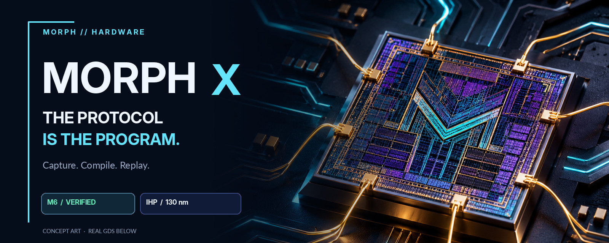
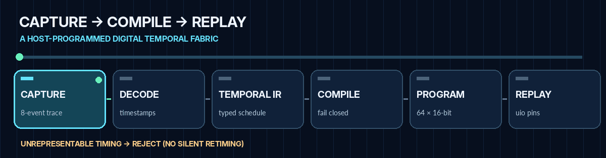
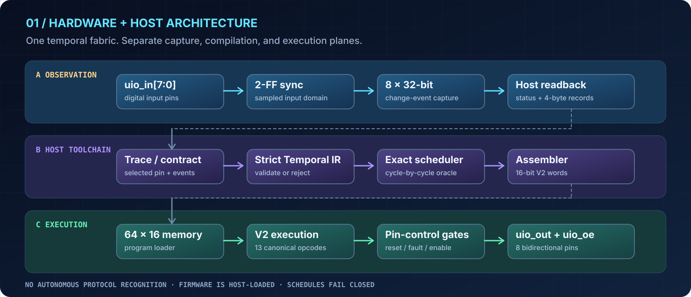
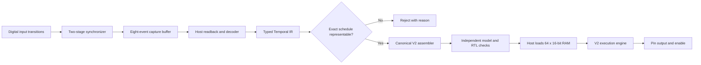
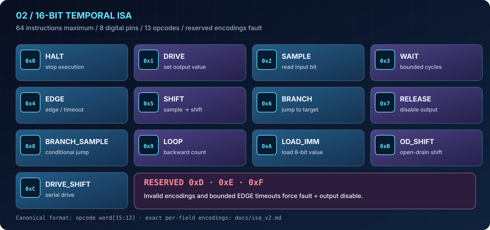
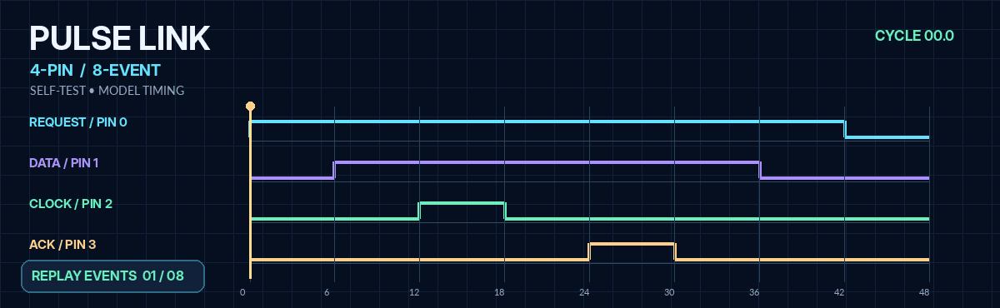
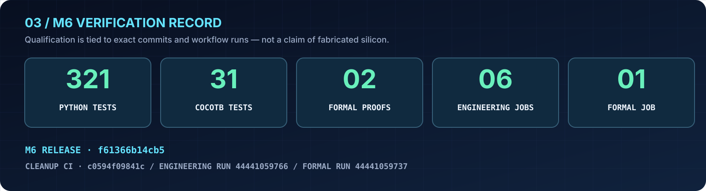
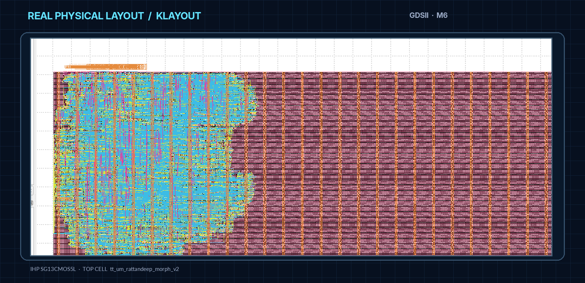
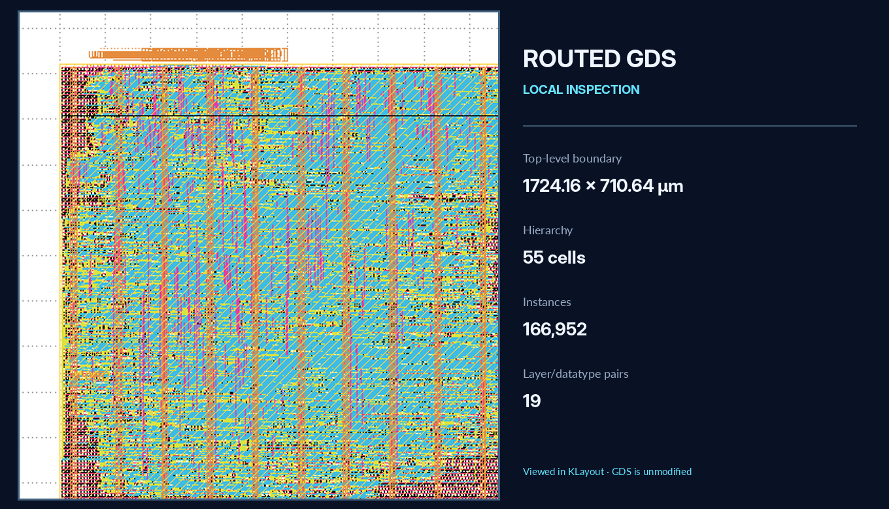

<p align="center">
  
</p>

<h1 align="center">MORPH X</h1>
<p align="center"><strong>Modular Open Reprogrammable Protocol Hardware</strong></p>
<p align="center">
  <em>One digital fabric. Multiple protocol behaviors. No new RTL for each waveform.</em>
</p>

<p align="center">
  <a href="https://github.com/Vlastimir0500/MORPH/actions/workflows/morph-engineering.yml"></a>
  <a href="https://github.com/Vlastimir0500/MORPH/actions/workflows/morph-formal-qualification.yml"></a>
  <a href="https://github.com/Vlastimir0500/MORPH/tree/morph-x-m6-v0.7"></a>
  
  
</p>

<p align="center">
  <a href="#the-idea">The idea</a> ·
  <a href="#architecture">Architecture</a> ·
  <a href="#the-machine">The machine</a> ·
  <a href="#what-actually-works">Evidence</a> ·
  <a href="#physical-design">Physical design</a> ·
  <a href="#reproduce-it">Reproduce</a> ·
  <a href="#research-frontier">Roadmap</a>
</p>

> [!IMPORTANT]
> **Engineering-qualified RTL and GDS flow ≠ manufactured silicon.** MORPH X has passed the tests and GitHub physical-design gates linked below, but no fabricated-device performance, analog compliance, or third-party blind protocol adaptation is claimed. The opening hero is **concept artwork**; the routed GDS shown later is a **real KLayout inspection**.

---

## The idea

A conventional digital design instantiates a dedicated controller for each bus. **MORPH X explores a different boundary: what if a small silicon engine could execute a *temporal description* of a protocol instead?** A host prepares strict instructions; the on-chip fabric drives, samples, waits for edges, branches, shifts, or releases its eight protocol pins.

The research question is not whether arbitrary protocols can be emulated (they cannot on this implementation). It is whether a **bounded, explicit, verifiable temporal instruction set** can cover meaningfully different digital interactions on one post-fabrication-programmable engine — while rejecting schedules it cannot implement exactly.

<table>
<tr>
<td width="33%" align="center"><strong>01 / OBSERVE</strong><br/><sub>Sample eight synchronized digital inputs and record up to eight changed-value events.</sub></td>
<td width="33%" align="center"><strong>02 / TRANSLATE</strong><br/><sub>Decode a trace or typed contract, build Temporal IR, and validate a cycle-exact V2 program.</sub></td>
<td width="33%" align="center"><strong>03 / EXECUTE</strong><br/><sub>Load 16-bit firmware, drive or release protocol pins, and compare observed behavior against independent models.</sub></td>
</tr>
</table>

<p align="center"></p>
<p align="center"><sub>Animated pipeline illustration. These stages use host software; no autonomous on-chip protocol inference is claimed.</sub></p>

### The hardware, in numbers

| Core resource | M6 implementation | Interpretation |
|:--|:--|:--|
| **Protocol pins** | **8** bidirectional (`uio[7:0]`) | Digital input, output value, and output enable |
| **Instruction store** | **64 × 16-bit** | Flip-flop-based, written by the host; no guaranteed power-up contents |
| **Canonical ISA** | **13 implemented opcodes** | `0x0` through `0xC`; `0xD`–`0xF` are reserved |
| **Capture storage** | **8 × 32-bit events** | 16-bit timestamp, changed mask, sampled levels |
| **Clock target** | **50 MHz** (`20 ns` period) | Design constraint, **not** post-silicon frequency measurement |
| **Process / tile allocation** | **IHP SG13CMOS5L / Tiny Tapeout 8×4** | Physical-design target, not a standalone packaged die claim |
| **Fault behavior** | **Outputs disabled on invalid encoding or bounded edge timeout** | Safety checks exercise specified pin-output invariants |

---

## Architecture

<p align="center"></p>

MORPH X separates **hardware capabilities** from **host interpretation**:

- **Observation plane** — synchronized `uio_in` samples feed a bounded change-event recorder; a host reads the captured data through a documented `ui_in`/`uo_out` register interface.
- **Translation plane** — Python decoders and compiler components construct a typed Temporal IR, check representability, assemble canonical V2 words, and independently simulate expected transitions.
- **Execution plane** — a 64-word instruction memory feeds the V2 fetch/execute state machine, which controls pin values, output enables, a shift register, sampling, bounded edge waits, branching, and one counted loop.
- **Safety envelope** — reset, top-level enable, program mode, invalid encodings and timeout behavior constrain the output enables; released pins remain undriven.

**Start with the source:** [`rtl/morph_engine_v2.sv`](rtl/morph_engine_v2.sv) · [`tinytapeout-template-v2/src/morph_x_trace_capture.sv`](tinytapeout-template-v2/src/morph_x_trace_capture.sv) · [`tinytapeout-template-v2/src/project.v`](tinytapeout-template-v2/src/project.v) · [`compiler/`](compiler/) · [`docs/MORPH_X_MASTER_SPEC.md`](docs/MORPH_X_MASTER_SPEC.md).

### How an observed edge becomes replayable firmware



> **Representability is a feature, not a footnote.** The V2 machine is *single issue*. A `DRIVE` updates one selected pin at a time. Different pins cannot be driven on exactly the same cycle; inter-drive gaps of **1 or 3 clock cycles** cannot be represented. The compiler **rejects** these requests instead of silently moving edges. See [`docs/MORPH_X_MULTIPIN_V05.md`](docs/MORPH_X_MULTIPIN_V05.md).

---

## The machine

<p align="center"></p>

Each instruction is **16 bits**, with its opcode in `word[15:12]`. Reserved bits must be zero. The program counter addresses **64 words**. The engine supports digital sequencing, not unrestricted temporal parallelism.

<details>
<summary><strong>Explore every canonical opcode</strong></summary>

| Code | Mnemonic | Intent |
|:--:|:--|:--|
| `0x0` | `HALT` | Stop execution; does not automatically release outputs |
| `0x1` | `DRIVE` | Drive selected pin to a specified digital level |
| `0x2` | `SAMPLE` | Sample selected pin into one-bit register |
| `0x3` | `WAIT` | Insert a bounded temporal delay |
| `0x4` | `EDGE` | Wait for selected input transition with optional timeout |
| `0x5` | `SHIFT` | Shift one sampled bit into shift register |
| `0x6` | `BRANCH` | Change program counter |
| `0x7` | `RELEASE` | Disable selected pin output enable |
| `0x8` | `BRANCH_SAMPLE` | Conditional branch on sampled bit |
| `0x9` | `LOOP` | Single counted backward loop |
| `0xA` | `LOAD_IMM` | Load eight-bit immediate into shift register |
| `0xB` | `OD_SHIFT` | Open-drain-style shifted output |
| `0xC` | `DRIVE_SHIFT` | Drive shifted serial bit |
| `0xD`–`0xF` | *Reserved* | Invalid encoding: faults and disables outputs |

Exact field layouts, reserved-bit masks, and state transitions are specified in [`docs/isa_v2.md`](docs/isa_v2.md). That document — not this visual summary — is the encoding authority.
</details>

### Capture format

Each captured transition occupies one **32-bit** record:

```text
  31                     16 15                8 7                0
  ┌────────────────────────┬────────────────────┬──────────────────┐
  │ 16-bit cycle timestamp │ 8-bit changed mask │ 8-bit pin levels │
  └────────────────────────┴────────────────────┴──────────────────┘
        wraps at 65,536         which pins moved       latest sampled value
```

The buffer is **eight events**, not a streaming logic analyzer. On overflow the trace is invalid for faithful reconstruction. A readout temporarily pauses capture, and multiple full counter wraps cannot be disambiguated. See [`docs/MORPH_X_CAPTURE_V01.md`](docs/MORPH_X_CAPTURE_V01.md).

---

## From instructions to waveforms

MORPH X includes scoped UART, SPI and I²C programs and a four-pin **Pulse Link** protocol-neutral demonstration. These validate representative digital sequences and error handling; they are **not** general standards certification or physical peripheral interoperability results.

| Demonstration | Source | Evidence scope |
|:--|:--|:--|
| **UART** | [`v2_uart_tx_a5.morph`](protocols/v2_uart_tx_a5.morph) · [`v2_uart_rx_a6.morph`](protocols/v2_uart_rx_a6.morph) | Tested TX/RX byte patterns, framing/error behavior |
| **SPI** | [`mode0`](protocols/v2_spi_mode0_a5.morph) · [`mode1`](protocols/v2_spi_mode1_a5.morph) · [`mode2`](protocols/v2_spi_mode2_a5.morph) · [`mode3`](protocols/v2_spi_mode3_a5.morph) | Tested programmed `0xA5` transfers across modes 0–3 |
| **I²C** | [`write`](protocols/v2_i2c_write_a5_3c.morph) · [`probe`](protocols/v2_i2c_address_probe.morph) | Tested addressing, ACK/NACK, and release cases |
| **Multi-pin replay** | [`compiler/morph_x_multireplay.py`](compiler/morph_x_multireplay.py) | Supported time-stamped pin-level schedules; rejects collisions |
| **Pulse Link** | [`8-edge challenge`](examples/morph_x_pulse_link_challenge.json) | Four-pin **self-test**, independent digital expected-trace oracle |

<p align="center"></p>
<p align="center"><sub><strong>Source-grounded animation:</strong> transitions come from <code>examples/morph_x_pulse_link_challenge.json</code> (cycles 0, 6, 12, 18, 24, 30, 36, 42). This is an illustrative rendering of a <em>self-test specification</em> — not a live logic-analyzer measurement.</sub></p>

### Timing is checked, not approximated

For supported replay schedules, the host scheduler maps requested event offsets into executable V2 words and checks the resulting output transitions against an independent reference model. The sequential fetch/execute behavior constrains reachable gaps. An unsupported schedule fails with a diagnostic instead of a falsified success trace. See [`docs/MORPH_X_TEMPORAL_IR_V1.md`](docs/MORPH_X_TEMPORAL_IR_V1.md) and [`docs/MORPH_X_MULTIPIN_V05.md`](docs/MORPH_X_MULTIPIN_V05.md).

---

## What actually works

<p align="center"></p>

The **frozen M6 baseline** is [`morph-x-m6-v0.7`](https://github.com/Vlastimir0500/MORPH/tree/morph-x-m6-v0.7), at commit [`f61366b`](https://github.com/Vlastimir0500/MORPH/commit/f61366b14cb5677476c5b029c5d621502015c400). A later **history-cleanup branch** was checked independently at [`c0594f0`](https://github.com/Vlastimir0500/MORPH/commit/c0594f09841c6d94d7867c43150640bb4b870ac2), without changing protected RTL, and its CI results were independently verified.

| Validation level | Observed result | Inspect |
|:--|:--|:--|
| Python model / compiler / negative regressions | **321 passed** | [`sim/`](sim/) |
| Cocotb top-level RTL tests | **31 passed, 0 failed, 0 skipped** | [`tinytapeout-template-v2/test/`](tinytapeout-template-v2/test/) |
| SymbiYosys / ABC-PDR safety properties | **2 proofs passed** | [`formal/qualification/`](formal/qualification/) |
| Yosys production RTL synthesis | **Passed** | [Engineering workflow](https://github.com/Vlastimir0500/MORPH/actions/runs/44441059766) |
| Gate-level simulation | **Passed** | [Engineering workflow](https://github.com/Vlastimir0500/MORPH/actions/runs/44441059766) |
| IHP GDS / Tiny Tapeout precheck | **Passed in referenced CI** | [GDS & precheck jobs](https://github.com/Vlastimir0500/MORPH/actions/runs/44441059766) |
| Custom post-route physical gate | **Passed in referenced CI** | [`scripts/check_physical_signoff.py`](scripts/check_physical_signoff.py) |
| Engineering CI jobs | **6 / 6 passed** | [Run `44441059766`](https://github.com/Vlastimir0500/MORPH/actions/runs/44441059766) |
| Separate formal CI job | **1 / 1 passed** | [Run `44441059737`](https://github.com/Vlastimir0500/MORPH/actions/runs/44441059737) |

Both linked cleanup runs above reference **the same commit** (`c0594f0`). The M6 release was also qualified at its own frozen SHA. Always check a run's `head_sha` before attributing its measurements to a particular GDS or source release.

<details>
<summary><strong>What the two formal proofs actually cover</strong></summary>

1. **Top-level output gating:** when `ena=0`, reset is asserted, or programming mode is active, the bidirectional output-enable vector must equal zero.
2. **Engine fault release:** following the assumed reset sequence, an asserted `fault` forces the engine's `pin_oe` vector to zero.

These **specified properties** do not prove full compiler correctness, all asynchronous capture behavior, or analog electrical safety. Source: [`morph_formal_gating.sv`](formal/qualification/morph_formal_gating.sv) and [`morph_formal_fault.sv`](formal/qualification/morph_formal_fault.sv).
</details>

---

## Physical design

The same source project is hardened for **IHP SG13CMOS5L**, using the Tiny Tapeout **8×4 tile** allocation and the open LibreLane/OpenROAD workflow. The local routed GDS can be opened in **KLayout**.

<p align="center"></p>
<p align="center"><sub><strong>Actual GDS screenshot</strong>, not AI concept art. Screenshot was supplied during local KLayout inspection. Layer colors reflect display configuration, not functional block labels.</sub></p>

<p align="center"></p>

The user's locally inspected final KLayout GDS (not independently matched to the GitHub Actions artifact) reported:

| GDS inspection field | Observed value |
|:--|:--|
| Top cell | `tt_um_rattandeep_morph_v2` |
| `prBoundary` bounding box | **1,724.16 × 710.64 µm** |
| Layout cells | **55** |
| Hierarchical instances | **166,952** |
| Layer/datatype pairs | **19** |
| Database unit | **0.001 µm** |
| Local GDS SHA-256 | `bb10938c0c726c51100c609c28cec6b08c030907d438dcc1e6b0243a442e6472` |

**Important:** `prBoundary` is a *design boundary* in the locally inspected GDS — not an independently measured packaged-chip die size. The counts above are hierarchy observations, not equivalent cell counts, gate equivalents, or transistor counts. The custom post-route CI gate is distinct from external foundry acceptance or measured fabricated-silicon timing.

The flow configuration, timing constraints, and checks live at [`config.json`](tinytapeout-template-v2/src/config.json), [`morph_pnr.sdc`](tinytapeout-template-v2/src/morph_pnr.sdc), [`morph_signoff.sdc`](tinytapeout-template-v2/src/morph_signoff.sdc), and [`check_physical_signoff.py`](scripts/check_physical_signoff.py). The [IHP Open PDK](https://github.com/IHP-GmbH/IHP-Open-PDK) is the external process reference.

---

## Reproduce it

**Choose a known commit** rather than mixing latest source with historical CI artifacts. Use Linux/WSL with compatible Python/pytest, Verilator, Icarus Verilog, Cocotb, Yosys/SymbiYosys/ABC, and GNU make. The repository CI workflows document the automation environments; the commands below presume those tools are already installed.

```bash
# Clone the repository and pin the frozen M6 verification baseline.
git clone https://github.com/Vlastimir0500/MORPH.git
cd MORPH
git fetch --tags
git checkout morph-x-m6-v0.7

# 1. Python regressions + Verilator differential tests
python -m pytest -q sim

# 2. Production Tiny Tapeout top-level Cocotb suite
make -C tinytapeout-template-v2/test clean
make -C tinytapeout-template-v2/test

# 3. Two scoped formal safety proofs
bash formal/qualification/run.sh

# 4. Strict release source/configuration audit
python3 scripts/morph_x_m6_release.py audit --strict
```

Compile a typed temporal contract and inspect its report:

```bash
mkdir -p build
python compiler/morph_contract_v2.py \
  protocols/v2_edge_timed_release.contract.json \
  -o build/v2_edge_timed_release.contract-report.json \
  -a build/v2_edge_timed_release.generated.morph
```

Generate and evaluate an **explicitly non-blind self-test**:

```bash
python compiler/morph_x_protocol_zero.py generate-selftest \
  --seed 23456 --output build/m5/selftest.json
python compiler/morph_x_protocol_zero.py prepare \
  build/m5/selftest.json --output-dir build/m5/firmware
```

For GDS, precheck, gate-level and physical reports, inspect the matching GitHub workflow artifacts instead of treating a screenshot as a signoff result:

```bash
gh run view 44441059766 --repo Vlastimir0500/MORPH
gh run view 44441059737 --repo Vlastimir0500/MORPH
```

See the [M6 exact-commit qualification checklist](docs/MORPH_X_M6_RELEASE_CHECKLIST.md) for the full evidence bundle workflow and branch/tag constraints.

---

## Where everything lives

```text
MORPH/
├── rtl/                          # frozen V2 temporal instruction engine
├── compiler/                     # assembler, Temporal IR, replay, oracle
├── protocols/                    # UART / SPI / I²C firmware and contracts
├── sim/                          # Python models, Verilator differential tests
├── formal/qualification/         # scoped SBY safety properties
├── traceforge/                   # trace contracts, tools, evidence reports
├── tinytapeout-template-v2/      # Tiny Tapeout wrapper, capture, physical flow
│   ├── src/                      # production source + PnR / signoff config
│   └── test/                     # Cocotb top-level integration tests
├── scripts/                      # full qualification and physical gates
├── docs/                         # ISA, release checklists, limitations, research
└── assets/readme/                # illustrated diagrams and animations
```

The cleaned source branch preserves essential code and reference materials while removing historical generated runs from Git tracking. The original M6 tag preserves the prior tracked history. See [`docs/MORPH_X_M6_RELEASE_CHECKLIST.md`](docs/MORPH_X_M6_RELEASE_CHECKLIST.md).

---

## Research frontier

MORPH X is built around a testable hypothesis: **how much digital protocol diversity can a small fixed engine cover through a validated timing program, without changing the RTL?**

| Milestone | State | What it means |
|:--|:--|:--|
| **V2 temporal engine** | ✅ Verified baseline | 16-bit ISA, protocol firmware, fault handling, design flow |
| **M1–M3 capture + host replay** | ✅ Tested in M6 suite | Bounded digital trace, decoder, typed IR, top-level integration |
| **M4 multi-pin temporal scheduling** | ✅ Tested for supported traces | Exactly timed *representable* pin transitions |
| **M5 Pulse Link / seeded waveforms** | ✅ Self-test evidence | Protocol-neutral digital waveform + independent oracle |
| **M6 release qualification** | ✅ Exact-commit engineering evidence | Python, RTL, formal, GDS, precheck, gate-level, post-route checks |
| **Protocol Zero (external blind trial)** | ⬜ Not yet demonstrated | Reviewer reveals unknown digital protocol only after hardware freeze |
| **Fabricated device / bring-up** | ⬜ Not yet demonstrated | Hardware measurement, power/timing characterization, external bus trials |

The strongest next experiment is **Protocol Zero**: freeze the hardware, publish hashes, let an independent evaluator choose a previously unseen digital protocol, change only host-side IR/firmware, then measure whether the frozen engine can execute the required waveform exactly — including recording rejections. The protocol and acceptance checklist already exist at [`docs/MORPH_X_PROTOCOL_ZERO_CHALLENGE.md`](docs/MORPH_X_PROTOCOL_ZERO_CHALLENGE.md) and [`docs/MORPH_X_PROTOCOL_ZERO_EVIDENCE_CHECKLIST.md`](docs/MORPH_X_PROTOCOL_ZERO_EVIDENCE_CHECKLIST.md).

### Read the research manuscript

[**MORPH X: Architecture, Compilation, Verification and Physical Design — technical research draft (PDF)**](docs/research/MORPH_X_Research_Paper.pdf)

This companion manuscript is a **technical draft**, not a peer-reviewed publication. Claims of novelty or superiority require controlled comparisons and independently reproducible measurements.

<details>
<summary><strong>Research integrity: explicit non-claims</strong></summary>

- No fabricated MORPH X chip, physical silicon demonstration or measured on-die power/frequency.
- No autonomous on-chip protocol identification, self-modifying firmware, or arbitrary waveform generation.
- No USB, Ethernet, or complete UART/SPI/I²C electrical/standards certification.
- No third-party post-freeze blind Protocol Zero acceptance; seeded examples are **self-tests**.
- No formal proof of arbitrary compiler correctness or all capture-hardware properties.
- No exact simultaneous changes to different pins in the current single-issue V2 engine.
- No exhaustive metastability, contention, voltage compatibility, signal-integrity or analog characterization.

These boundaries are tracked in [`docs/MORPH_X_M6_LIMITATIONS.md`](docs/MORPH_X_M6_LIMITATIONS.md).
</details>

---

## Author & provenance

**VLastimir** · [GitHub @Vlastimir0500](https://github.com/Vlastimir0500) · MORPH X research and engineering.

The design is developed with AI-assisted support for parts of coding, review, documentation and visualization. Source changes and engineering claims are checked against executable tests and evidence; AI assistance does not replace independent validation. This README's custom illustration is **concept art**; the diagrams and animated self-test waveform are explanatory graphics, and the KLayout panels derive from an actual GDS screenshot. Full media provenance is in [`assets/readme/PROVENANCE.md`](assets/readme/PROVENANCE.md).

<p align="center"></p>
<p align="center"><strong>MAKE THE TIMING PROGRAMMABLE.</strong><br/><sub>Keep the claims falsifiable.</sub></p>
